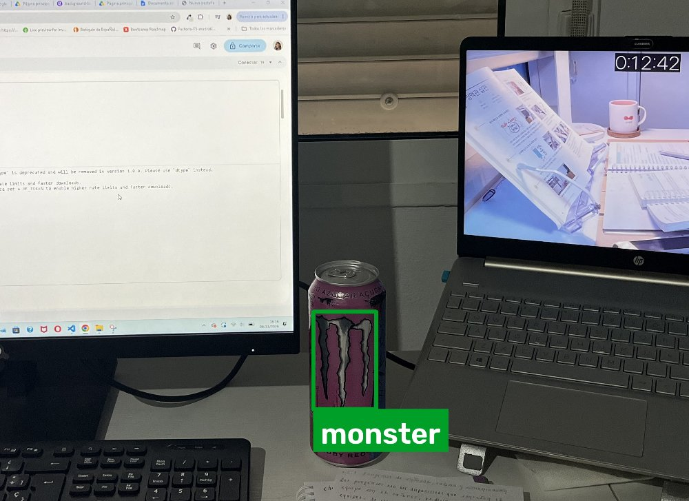

# Background Buzz

[](https://github.com/camiua/background-buzz/actions/workflows/ci.yml)

> *Revealing energy drink ads in gaming streams*

Background Buzz detecta logos de bebidas energéticas en imágenes y vídeos de streams de gaming con un modelo de visión por computador (YOLO).

**Para quién:** organizaciones de salud y observatorios de consumo que quieren medir cuánto se expone el público joven a estas marcas sin revisar horas de vídeo a mano.



## Estado

Prueba de concepto del bootcamp de IA de Factoría F5. El proyecto avanza por los niveles del briefing; cada nivel cerrado tiene su tag de Git.

| Nivel | Qué hace | Estado |
|---|---|---|
| 🟢 Esencial | Detecta los logos en una imagen y dibuja una caja con el nombre de la marca | ✅ `v1-esencial` |
| 🟡 Medio | Procesa vídeos, con el nombre de la marca debajo de cada detección | En curso |
| 🟠 Avanzado | Confianza en pantalla, base de datos e informe de tiempo y porcentaje por marca | Pendiente |

**Marcas del modelo v1:** Monster y Burn. Red Bull queda para una versión posterior.

## Cómo funciona

```
imagen ─► detect_image.py ─► Detector (model.py) ─► detecciones ─► drawing.py ─► imagen con cajas
                │                                   (marca, confianza, caja)
           config.py (.env: ruta del modelo y umbral de confianza)
```

1. **Modelo:** YOLO11 nano preentrenado y reentrenado con un dataset propio (transfer learning). El entrenamiento está en [`notebooks/train_yolo.ipynb`](notebooks/train_yolo.ipynb) y se documenta en [`docs/entrenamiento.md`](docs/entrenamiento.md).
2. **Detección:** `app/detector/model.py` es el único archivo que conoce el modelo. Devuelve cada logo con su marca, su confianza y su caja.
3. **Dibujo:** `app/detector/drawing.py` dibuja cada caja con un color fijo por marca y el nombre debajo, con fondo para que se lea sobre cualquier imagen.

## Instalación

Requisitos: [uv](https://docs.astral.sh/uv/) y Git.

```bash
git clone https://github.com/camiua/background-buzz.git
cd background-buzz/backend
uv sync --group train
```

`--group train` instala Ultralytics (y PyTorch), necesario para usar el modelo en este nivel.

**El modelo** no está en el repositorio. Descarga `best-v1-2-marcas-e100.pt` de la [release `v1-esencial`](https://github.com/camiua/background-buzz/releases/tag/v1-esencial) y guárdalo en `backend/models/`.

**La configuración** va en un archivo `.env` en la raíz del repositorio (hay una plantilla en `.env.example`):

```
MODEL_PATH=models/best-v1-2-marcas-e100.pt
CONFIDENCE_THRESHOLD=0.5
```

`CONFIDENCE_THRESHOLD` es la confianza mínima (de 0 a 1) para mostrar una detección.

## Uso

Desde `backend/`:

```bash
uv run python -m scripts.detect_image ruta/a/imagen.jpg
```

El script muestra cada logo detectado (marca, confianza y caja) y guarda la imagen con las cajas en `backend/data/outputs/<nombre>_detecciones.jpg`. Con `--output` se elige otra ruta.

## Modelo v1

| Métrica (test) | Burn | Monster |
|---|---|---|
| Precision | 0,996 | 1,000 |
| Recall | 1,000 | 1,000 |
| mAP50 | 0,995 | 0,995 |
| mAP50-95 | 0,776 | 0,765 |

**Estas métricas son optimistas:** el test es un solo vídeo grabado en el mismo entorno que el entrenamiento. Con capturas de streams reales el modelo falla más: no reconoce variantes de lata que no ha visto y puede confundir manchas rojas con la llama de Burn. Los detalles y las limitaciones están en [`docs/entrenamiento.md`](docs/entrenamiento.md).

## Estructura

```
background-buzz/
├── .specify/          ← spec, plan y tareas (la fuente de verdad del diseño)
├── backend/
│   ├── app/
│   │   ├── config.py  ← lee el .env
│   │   └── detector/  ← modelo y dibujo
│   ├── scripts/       ← scripts de terminal
│   └── models/        ← pesos del modelo (no se suben)
├── notebooks/         ← entrenamiento en Kaggle
└── docs/              ← entrenamiento, decisiones y aprendizajes
```

## Desarrollo

```bash
uv run ruff check .          # errores y malas prácticas
uv run ruff format --check . # formato
uv run pytest                # tests
```

Antes del primer commit, instala los hooks de pre-commit (detector de secretos y estilo) desde la raíz del repositorio:

```bash
uv tool install pre-commit
pre-commit install
```

Flujo de trabajo: una rama por tarea desde `develop`, commits convencionales y PR con el CI en verde. Las tareas están en [`.specify/3_tasks.md`](.specify/3_tasks.md) y en el tablero de GitHub Projects.

## Licencia

[AGPL-3.0](LICENSE), por Ultralytics YOLO.
